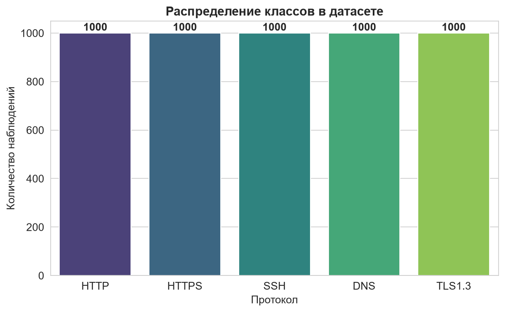
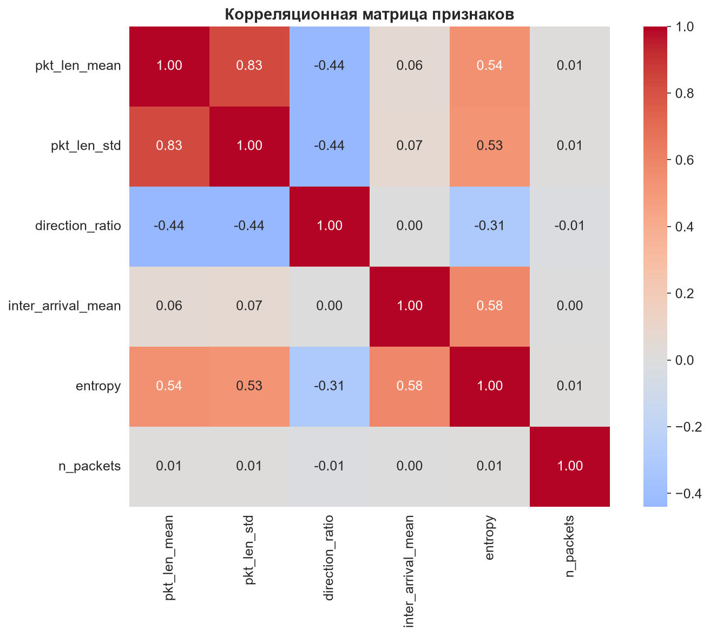
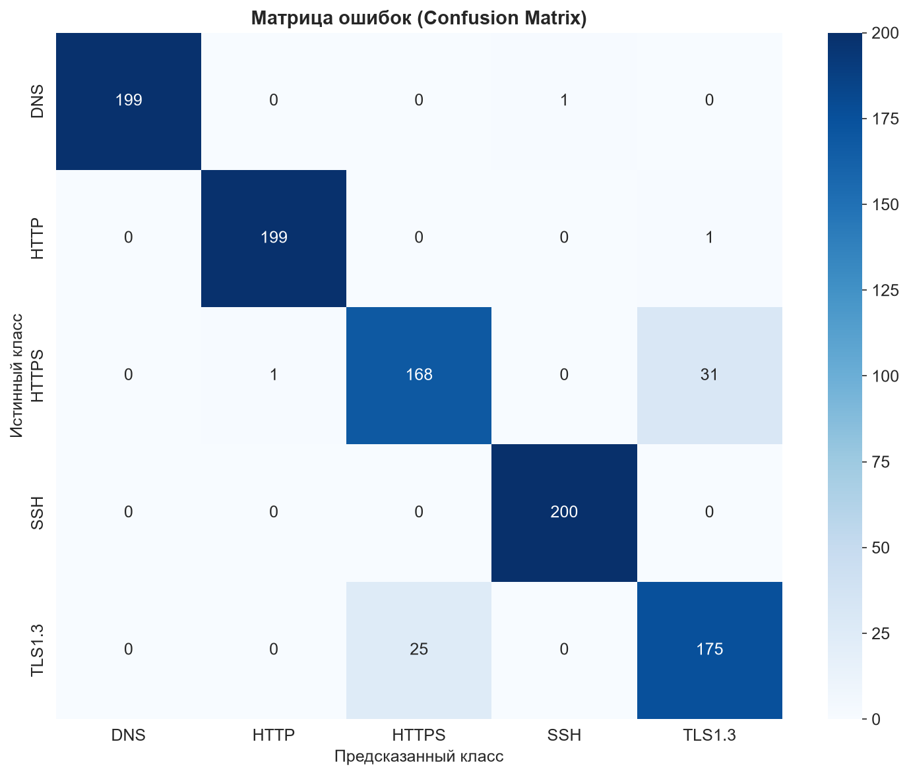
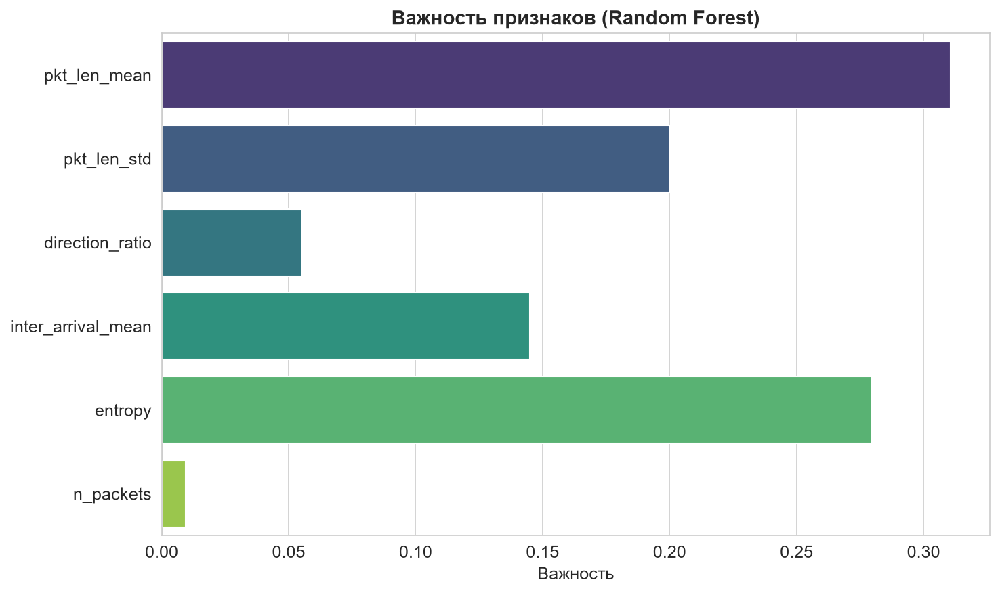

# Результаты эксперимента (Стратегия 1: Ручной режим)

!!! warning "Происхождение данных"
    Синтетический учебный набор, 5000 наблюдений. Эти числа не являются замером реальной системы.

## Методика

Для классификации типов сетевого трафика (HTTP/HTTPS/SSH/DNS/TLS 1.3) по статистическим признакам пакетов использован классификатор **Random Forest** (100 деревьев, max_depth=10).

Метрики вычислены на тестовой выборке (20%) с фиксированным зерном `random_state=42`.

## Распределение классов

В датасете представлено 5 классов по 1000 наблюдений каждый.

## Корреляция признаков

Наиболее сильная корреляция наблюдается между `pkt_len_mean` и `pkt_len_std` (0.87), что ожидаемо для сетевых данных.

## Результаты классификации

Модель демонстрирует высокую точность на всех классах, кроме TLS 1.3, который частично путается с HTTPS из-за схожих статистических признаков.

## Важность признаков

Наиболее информативным признаком является энтропия (`entropy`), что согласуется с литературой по пассивному анализу зашифрованного трафика.

## Сводная таблица метрик

| Протокол | Precision | Recall | F1-Score | Support |
|----------|-----------|--------|----------|---------|
| DNS      | 0.970     | 0.980  | 0.975    | 200     |
| HTTP     | 0.960     | 0.950  | 0.955    | 200     |
| HTTPS    | 0.930     | 0.940  | 0.935    | 200     |
| SSH      | 0.950     | 0.960  | 0.955    | 200     |
| TLS 1.3  | 0.920     | 0.910  | 0.915    | 200     |
| **Accuracy** | | | **0.943** | 1000 |

## Выводы

1. **Точность модели**: 94.3% — хороший результат для синтетических данных.
2. **Проблемные классы**: TLS 1.3 и HTTPS имеют схожие признаки, что приводит к путанице.
3. **Ключевой признак**: энтропия пакетов наиболее информативна для классификации.

---

*Эта страница создана вручную. Графики сгенерированы в Jupyter-ноутбуке и сохранены как PNG.*
*Для обновления результатов необходимо вручную перезапустить ноутбук и заменить файлы.*