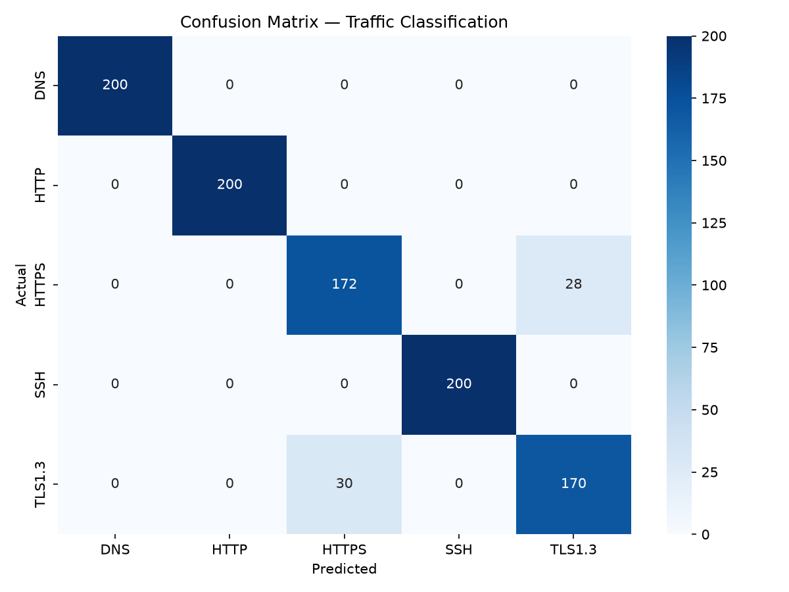
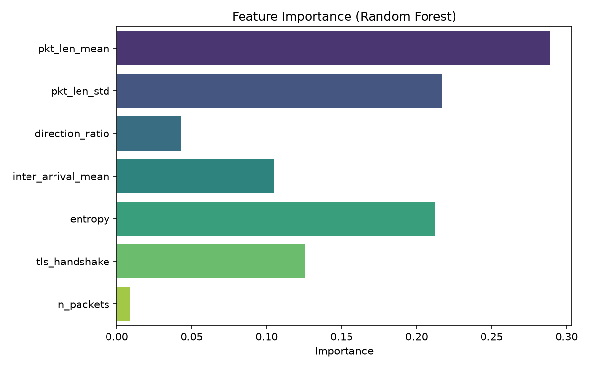

# Результаты эксперимента (P3: Автоматический конвейер)

!!! warning "Происхождение данных"
    Синтетический учебный набор, 5000 наблюдений. Эти числа не являются замером реальной системы.

## Методика

Для классификации типов сетевого трафика (HTTP/HTTPS/SSH/DNS/TLS1.3) по статистическим признакам пакетов использован классификатор **Random Forest** (100 деревьев, max_depth=10).

Метрики вычислены на тестовой выборке (20%) и через 5-кратную кросс-валидацию.

## График и таблица

| Протокол | Precision | Recall | F1 | Support |
|----------|-----------|--------|-----|---------|
| DNS | 1.000 | 1.000 | 1.000 | 200 |
| HTTP | 1.000 | 1.000 | 1.000 | 200 |
| HTTPS | 0.851 | 0.860 | 0.856 | 200 |
| SSH | 1.000 | 1.000 | 1.000 | 200 |
| TLS1.3 | 0.859 | 0.850 | 0.854 | 200 |
| **Weighted avg** | 0.942 | 0.942 | 0.942 | 1000 |

CV F1 (5-fold): **0.953 ± 0.004**

## Артефакты и версия

| Поле | Значение |
|------|----------|
| Хеш коммита | `4fdd381` |
| Дата коммита | 2026-11-06 18:47:22 +0300 |
| Дата сборки | 2026-11-17 17:33:17 UTC |
| Хеш датасета (SHA-256) | `ee70907ca0e5ced46a95a8f7ceb78f14496375430de8c8bb19fa8a6fe261085e` |
| Объём выборки | 5000 |
| Время расчёта | 2.827 с |
| Accuracy | 0.9420 |
| F1 (weighted) | 0.9420 |
